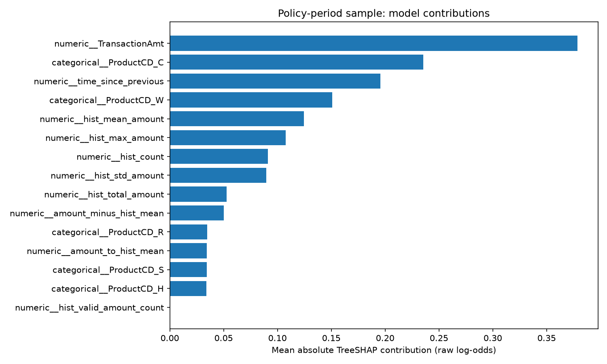

# Transaction Risk Lab

A fraud risk analysis and offline batch review pipeline built with
Python, DuckDB, scikit-learn, and LightGBM using IEEE-CIS transaction data.

## Objective

Prioritize transactions for manual review under a maximum review
capacity of 1%.

The project compares simple baselines and supervised learning models,
evaluates historical behavioral features, and develops a review policy
with a 50% development False Discovery Rate (FDR) target.

**Final outcome:** The capacity constraint was respected, but the
50% FDR target did not generalize to the held-out test period.

## Data

Source: [IEEE-CIS Fraud Detection](https://www.kaggle.com/competitions/ieee-fraud-detection/data)

The project uses:
- `train_transaction.csv`: 590,540 transactions.
- `train_identity.csv`: 144,233 identity records.

The competition training data is divided into internal chronological
development and test periods. The competition's unlabeled test files
are not used.

Raw data and serialized model artifacts are excluded from Git.
Obtain the source data through Kaggle under the competition rules.

### Selected Fields

| Field | Meaning | Role |
|---|---|---|
| TransactionID | Unique transaction identifier | Join key and deterministic tie-breaker |
| TransactionDT | Elapsed time from a reference point | Chronological splitting and historical features |
| TransactionAmt | Transaction payment amount | Numerical feature |
| isFraud | 1 for fraud, 0 for legitimate | Prediction target |
| ProductCD | Masked product code | Categorical feature |
| card1, card4, addr1 | Masked card and address fields | Proxy-group construction |
| DeviceType, DeviceInfo | Device information | Data quality and exploratory analysis |

The selected models use TransactionAmt, ProductCD, and, where applicable,
historical features. Device fields are not inputs to the selected model.

## Evaluation Design

| Split | Approximate Share | Transactions | Purpose |
|---|---:|---:|---|
| Train | 55% | 324,797 | EDA and model training |
| Validation | 10% | 59,054 | Model and feature comparison |
| Calibration | 10% | 59,054 | Calibrator fitting |
| Policy | 10% | 59,054 | Calibration comparison and policy selection |
| Test | 15% | 88,581 | Final held-out evaluation |

Transactions sharing the same TransactionDT remain in the same split.

Three expanding-window backtests were also performed within the
training period.

After model selection, LightGBM was refitted on train and validation:
383,851 transactions.

## Pipeline

1. Load selected CSV columns.
2. Validate IDs and perform a one-to-one SQL LEFT JOIN.
3. Validate target, time, amount, and JOIN integrity.
4. Export Parquet and verify round-trip equality.
5. Create chronological splits and training-only EDA reports.
6. Generate 10 historical features.
7. Compare baselines, Logistic Regression, and LightGBM.
8. Evaluate sigmoid calibration and select a review policy.
9. Verify stateful replay and produce descriptive monitoring.
10. Evaluate the frozen model and policy on the held-out test period.
11. Generate policy-period TreeSHAP explanations.

## Historical Features

Proxy groups are defined by card1, card4, and addr1.
They are not verified customer or card identities.

Only strictly earlier transactions contribute to history.
Same-time transactions are excluded.

Features include historical count, valid-amount count, mean, population
standard deviation, maximum, total, time since previous transaction,
amount-to-mean ratio, amount-minus-mean difference, and a new-group indicator.

Transactions with missing group fields are preserved, with missing
historical features.

See [feature dictionary](reports/feature_dictionary.md).

## Development Results

All validation methods used the same capacity of 590 transactions.

| Method | Fraud Hits | Precision | Recall |
|---|---:|---:|---:|
| Random selection: 100-seed mean | 21.24 | 3.60% | 1.00% |
| Highest transaction amount | 22 | 3.73% | 1.04% |
| Logistic Regression base | 75 | 12.71% | 3.53% |
| Logistic Regression history | 61 | 10.34% | 2.87% |
| LightGBM base | 142 | 24.07% | 6.68% |
| LightGBM history | 182 | 30.85% | 8.56% |

Historical features improved LightGBM validation results but reduced
Logistic Regression performance.

Across three training-period backtests, mean recall was 6.01% for
LightGBM history and 5.80% for LightGBM base. History improved recall
in two of three folds, so its contribution was not consistent across
all periods.

## Calibration and Review Policy

Sigmoid calibration did not improve policy-period Brier score or
log loss. Raw model scores were retained.

The selected policy:
- Uses offline batch ranking.
- Applies a score threshold of approximately 0.384266.
- Reviews at most 1% of transactions in the supplied batch.
- Breaks score ties by TransactionID ascending.

The threshold was selected using policy-period labels under a
50% observed FDR target. This is not a statistical FDR guarantee.

## Held-Out Test Results

| Metric | Result |
|---|---:|
| Test transactions | 88,581 |
| Reviewed transactions | 535 |
| Fraud detected | 40 of 3,083 |
| Precision | 7.48% |
| Recall | 1.30% |
| FDR | 92.52% |
| Review rate | 0.60% |
| Average Precision | 0.0965 |
| ROC AUC | 0.7636 |

The review capacity constraint was respected.
**The 50% FDR target was not met.**

Policy-period precision did not generalize to the later test period.
This demonstrates why ranking metrics and development-period threshold
performance are insufficient to establish operational reliability.

The final test has been observed. Subsequent tuning against this period
would be exploratory and would require new unseen data for independent
evaluation.

See [final findings](reports/final_findings.md).

## Replay and Monitoring

All 10 historical features were compared between DuckDB SQL and Python
replay across 501,959 development transactions.

Checks cover:
- Same-time exclusion.
- Future-amount invariance.
- Input row-order invariance.
- Missing group keys.
- Checkpoint serialization and resume.
- Duplicate retry without repeated state updates.
- Conflicting duplicate rejection.
- Late-arrival rejection.
- Parquet round-trip equality.

The full validation workflow took approximately 97.88 seconds on the
local machine. This is not a production latency benchmark.

Monitoring compares missing rates, medians, and descriptive PSI between
train and policy periods. Distribution differences alone do not establish
model degradation.

## Model Explanations

TreeSHAP contributions were computed for 1,000 sampled policy-period
transactions and verified to sum to raw model margins.

TransactionAmt, ProductCD_C, and time_since_previous had the largest
mean absolute contributions in this sample.

Contributions explain raw log-odds, not causation.



## Setup

Developed using Python 3.13.5.

Create and activate a virtual environment from the project root:

```bash
python3 -m venv .venv
source .venv/bin/activate
python -m pip install -r requirements.txt
```

On macOS, LightGBM may also require OpenMP:

```bash
brew install libomp
```

Place the extracted source files here:

```text
data/raw/train_transaction.csv
data/raw/train_identity.csv
```

## Run

Run all commands from the project root.

### Data and Features

```bash
python -m src.data_pipeline
python -m src.time_split
python -m src.eda
python -m src.features
```

### Development Experiments

```bash
python -m src.baseline
python -m src.modeling
python -m src.backtesting
```

### Model and Policy Construction

For a fresh local reproduction:

```bash
python -m src.calibration
python -m src.policy
```

The calibration script rewrites model artifacts.
The saved policy is tied to a model-bundle SHA-256 hash and rejects
configuration changes.

An existing artifact directory should be preserved. For a fresh
reproduction, use a separate checkout with its own artifact directory
rather than deleting or overwriting the original evaluation records.

### Tests and Replay Verification

```bash
python -m pytest tests -v
python -m src.replay_validation
```

### Final Evaluation and Explanations

Requires the local model bundle and saved review policy:

```bash
python -m src.final_evaluation
python -m src.explanations
```

If the final report exists, the evaluation script displays it rather
than reevaluating the test. Model and policy checks run first.

Serialized model files are not included in this repository.
The saved JSON report can be read without recreating model artifacts.

## Limitations

- Proxy groups may combine unrelated customers or cards.
- TransactionDT is not a real calendar timestamp.
- Feature availability at decision time is an offline assumption.
- The dataset does not fully establish label availability delays.
- Current ingestion and replay reject missing or non-finite amounts.
- Same-time transactions must remain together during replay.
- Replay state and duplicate signatures are held in memory.
- Replay parity does not validate end-to-end scoring and review execution.
- The review policy is batch-based, not a live streaming service.
- The split protocol does not currently fingerprint source data.
- The final-report guard checks model and policy compatibility, not
  complete data and code provenance.
- No production deployment or financial savings are claimed.

## Possible Future Work

- Validate on a genuinely unseen period.
- Investigate threshold instability using development-only analyses.
- Add uncertainty estimates for review precision.
- Compare rolling-window historical features.
- Add source-data fingerprints and stronger artifact versioning.
- Extend monitoring to score distributions and delayed-label performance.